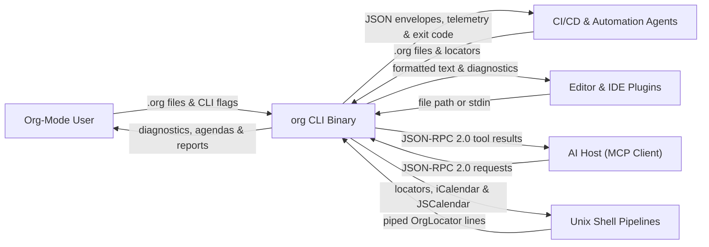
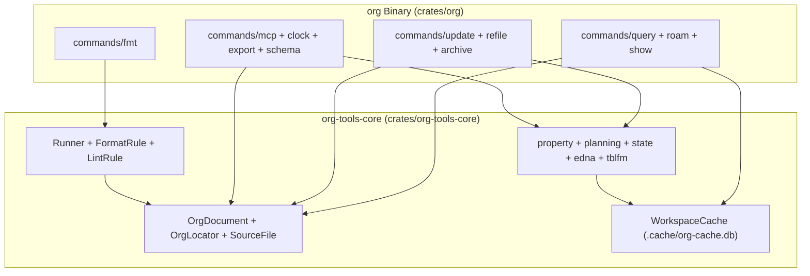
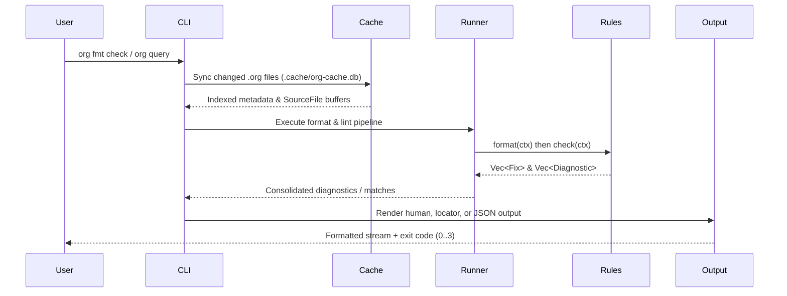
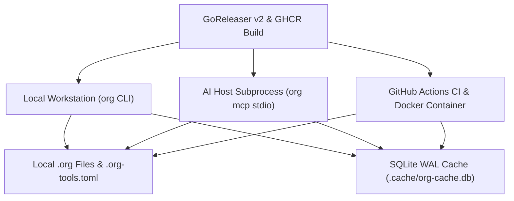

<!--
Copyright (C) 2026 org-tools contributors
SPDX-License-Identifier: GPL-3.0-or-later
-->

# Architecture Documentation (`arc42`)

**What you will learn:**

- How the 12-section `arc42` architecture dossier structures `org-tools` goals, constraints, and runtime flows.
- How `crates/org-tools-core` and `crates/org` divide parsing, caching, formatting, querying, and mutation duties.
- How four balanced Mermaid diagrams map system context, building blocks, runtime sequences, and deployment topologies.

## 1. Introduction and Goals

`org-tools` provides a unified Command-Line Interface (CLI) for Org-mode files in pure Rust.
It delivers linting, formatting, querying, updating, clocking, archiving, and exporting without requiring Emacs.
Teams and automation agents run a single static binary across workstations and continuous integration pipelines.

### 1.1 Requirements Overview

- **Standalone Execution**: Run as a single native binary with zero Emacs or external runtime dependencies.
- **High Speed**: Process hundreds of Org-mode files in sub-second wall-clock time.
- **Specification Parity**: Match the Org-mode specification and Emacs `org-lint` behavior wherever feasible.
- **File Safety**: Preserve literal content inside protected regions (`src`, `example`, `quote`, `verse`, `export`).
- **Declarative Configuration**: Configure rules and defaults via `.org-tools.toml` using Tom's Obvious Minimal Language (TOML).
- **Unix Composability**: Chain subcommands via `OrgLocator` strings and schema-validated JSON envelopes over `stdin` and `stdout`.

### 1.2 Quality Goals

| Priority | Quality Goal  | Description                                                                                   |
| -------- | ------------- | --------------------------------------------------------------------------------------------- |
| P1       | Correctness   | Rules and mutators match the Org-mode manual, formal syntax, and Emacs behavior.              |
| P2       | Safety        | Format rules never modify literal content inside protected block regions.                     |
| P3       | Performance   | Warm queries and checks finish in milliseconds across hundreds of workspace files.            |
| P4       | Extensibility | Contributors add a rule by implementing one trait, writing tests, and registering the struct. |
| P5       | Composability | Subcommands pipe cleanly via `OrgLocator` addresses and `MutationResult` JSON envelopes.      |

### 1.3 Stakeholders

| Role              | Expectations                                                                                                      |
| ----------------- | ----------------------------------------------------------------------------------------------------------------- |
| Org-mode users    | Consistent formatting, rapid mistake detection, and reliable Getting Things Done (GTD) agendas.                   |
| CI/CD & AI agents | Schema-validated JSON envelopes, execution telemetry, `stdio` Model Context Protocol (MCP) tools, and exit codes. |
| Script authors    | Locator-based Unix piping and Deterministic RFC 9562 Universally Unique Identifier Version 5 (UUIDv5) minting.    |
| Rule contributors | Clear trait boundaries, Red-to-Green Test-Driven Development (TDD) harnesses, and independent rule modules.       |

## 2. Architecture Constraints

### 2.1 Technical Constraints

| Constraint         | Rationale                                                                                                 |
| ------------------ | --------------------------------------------------------------------------------------------------------- |
| Pure Rust          | Produces a standalone cross-platform binary with predictable memory use and fast startup.                 |
| Line-based parser  | Keeps structural complexity low and avoids unmaintained external Abstract Syntax Tree (AST) dependencies. |
| `GPL-3.0-or-later` | Honors the licensing conventions of Emacs and the broader Org-mode ecosystem.                             |
| Zero Emacs runtime | Enables execution inside minimal containers, CI runners, and editor plugins without Emacs installed.      |

### 2.2 Conventions

| Convention            | Description                                                                                    |
| --------------------- | ---------------------------------------------------------------------------------------------- |
| Rule ID scheme        | `F` = format, `E` = error, `W` = warning, `I` = info followed by three digits.                 |
| Configuration format  | `.org-tools.toml` discovered by walking upward from the working directory.                     |
| Output formats        | Human-readable text (default), Draft 2020-12 JSON envelopes, and `OrgLocator` strings.         |
| Specification sources | Org Mode Manual, Org Syntax formal specification, `org-lint.el`, and `docs/org-ecosystem.org`. |

## 3. Context and Scope

### 3.1 Business Context

`org` reads `.org` files from local storage and executes formatting, linting, querying, or mutations.
Human users, editors, shell pipelines, and Model Context Protocol (MCP) clients interact through standard streams.



### 3.2 Technical Context

`org-tools` operates strictly on local files and standard input/output streams.
It performs zero outbound network requests and requires no external database daemon.

- **Inputs**: Local `.org` files, `.org-tools.toml` configuration, environment variables (`ORG_ID_NAMESPACE`, `ORG_TAG_COLUMN`, `NO_COLOR`), and `stdin`.
- **State Cache**: Incremental SQLite Write-Ahead Logging (WAL) and Full-Text Search Version 5 (SQLite FTS5) cache in `.cache/org-cache.db`.
- **Outputs**: Human diagnostics, `MutationResult` JSON envelopes, `OrgLocator` lines, iCalendar/JSCalendar feeds, and Prometheus metrics.

## 4. Solution Strategy

The repository uses a two-crate Cargo workspace separating core domain mechanics from CLI transport.
`crates/org-tools-core` implements parsing, rules, `OrgDocument` trees, `WorkspaceCache`, and mutation algorithms.
`crates/org` implements `clap` argument parsing, subcommand dispatch, output rendering, and `stdio` MCP transport.

### 4.1 Lint and Format Strategy

`org fmt` processes source text using line-indexed buffers and non-overlapping byte-span replacements:

1. Read each file into `SourceFile` and build an `O(log n)` line-start byte index.
1. Execute enabled `FormatRule` implementations to collect candidate `Fix` structs (`Span` plus replacement text).
1. Sort and deduplicate non-overlapping `Fix` spans, then apply replacements in one left-to-right pass.
1. Execute enabled `LintRule` implementations against the formatted buffer to collect `Diagnostic` structs.
1. Render diagnostics or formatted output in the requested human or JSON format.

### 4.2 Query, Cache, and Mutation Strategy

1. Load `OrgDocument` trees from `.org` files or query the warm `WorkspaceCache` in `.cache/org-cache.db`.
1. Resolve `OrgLocator` targets (`id:`, `#custom-id`, outline path, or line) or evaluate `Predicate` trees.
1. Apply lint-clean mutations (`F005` drawers, `F007` column-77 tags, Deterministic RFC 9562 UUIDv5 IDs) and emit `MutationResult`.

## 5. Building Block View

### 5.1 Level 1: Workspace Overview

The `org` binary delegates all parsing, indexing, and document mutations to `org-tools-core`.



### 5.2 Level 2: Module Decomposition (`org-tools-core`)

| Module          | Responsibility                                                                                              |
| --------------- | ----------------------------------------------------------------------------------------------------------- |
| `source.rs`     | Reads UTF-8 buffers, indexes line byte offsets, and resolves 1-based line and column coordinates.           |
| `document.rs`   | Builds `OrgDocument` heading trees, level-0 `org-roam` v2 `:PROPERTIES:` drawers, and `KEY+` continuations. |
| `entry.rs`      | Inserts headings, adjusts subtree levels, and parses plain-list `ChecklistItem` vectors.                    |
| `locator.rs`    | Parses, formats, and resolves `OrgLocator` addresses across headings and level-0 file nodes.                |
| `property.rs`   | Applies `F005` drawer edits, `F007` column-77 tag alignment, and Deterministic RFC 9562 UUIDv5 minting.     |
| `planning.rs`   | Advances repeaters (`+`, `++`, `.+`), evaluates deadline warnings, and mutates `SCHEDULED:` / `DEADLINE:`.  |
| `id.rs`         | Generates UUIDv4, custom template, and external-command `:ID:` properties.                                  |
| `state.rs`      | Transitions TODO states, manages `CLOSED:` timestamps, and triggers repeater advancement.                   |
| `logbook.rs`    | Records `:LOGBOOK:` state transitions, updates `:LAST_REPEAT:`, and computes `org-habit` summaries.         |
| `columns.rs`    | Parses `#+COLUMNS:` specifications and evaluates bottom-up property, effort, and clock rollups.             |
| `include.rs`    | Resolves workspace-confined `#+INCLUDE:` directives with line slicing and cycle detection.                  |
| `cache.rs`      | Maintains the incremental SQLite WAL and SQLite FTS5 `WorkspaceCache` in `.cache/org-cache.db`.             |
| `roam.rs`       | Resolves `org-roam` v2 file and heading nodes, `:ROAM_ALIASES:`, `:ROAM_REFS:`, and backlinks.              |
| `refile.rs`     | Moves heading subtrees across files or parent headings while adjusting asterisk depth.                      |
| `cookie.rs`     | Recalculates `[n/m]` and `[n%]` statistics cookies from child headings or checklists.                       |
| `archive.rs`    | Extracts completed `DONE` subtrees and writes `.org_archive` metadata headers.                              |
| `edna.rs`       | Parses and evaluates `org-edna` `BLOCKER` conditions and `TRIGGER` actions.                                 |
| `tblfm.rs`      | Evaluates pure-Rust `#+TBLFM:` spreadsheet formulas and flags Emacs-only expressions.                       |
| `export_md.rs`  | Extracts bounded document slices and exports GitHub Flavored Markdown.                                      |
| `runner.rs`     | Registers rules and orchestrates the two-phase format-then-lint execution pipeline.                         |
| `diagnostic.rs` | Defines `Span`, `Fix`, `Diagnostic`, and `Severity` value types.                                            |
| `formatter.rs`  | Applies sorted, non-overlapping `Fix` spans to source text in a single pass.                                |
| `config.rs`     | Loads `.org-tools.toml` configuration files from the current or ancestor directories.                       |
| `output.rs`     | Formats lint and format diagnostics as human-readable text or JSON.                                         |
| `files.rs`      | Walks directories recursively to collect `.org` files while respecting `.gitignore`.                        |
| `rules/`        | Defines `FormatRule` and `LintRule` traits, 9 `F` rules, and 38 `E`/`W`/`I` rules.                          |

### 5.3 Level 2: Module Decomposition (`org` Binary)

| Module                        | Responsibility                                                                                   |
| ----------------------------- | ------------------------------------------------------------------------------------------------ |
| `main.rs`                     | Parses top-level `clap` flags, defines exit codes (`0..3`), and dispatches subcommands.          |
| `commands/mod.rs`             | Provides shared `MutationResult` envelopes, execution `telemetry`, and file I/O helpers.         |
| `commands/fmt.rs`             | Implements `org fmt check` and `org fmt format` for files and piped `stdin`.                     |
| `commands/query.rs`           | Dispatches `org query search`, `columns`, and `deps` subcommands.                                |
| `commands/query_agenda.rs`    | Implements `org query agenda` with date ranges, warning windows, and `org-habit` status.         |
| `commands/query_gtd.rs`       | Implements Getting Things Done (GTD) views (`inbox`, `next`, `waiting`, `blocked`, `stuck`).     |
| `commands/roam.rs`            | Implements `org roam node`, `backlinks`, `links`, `graph`, `capture`, and `fleeting`.            |
| `commands/cache.rs`           | Implements `org cache status`, `rebuild`, and `clear` for `.cache/org-cache.db`.                 |
| `commands/refile.rs`          | Implements `org refile` cross-file and in-file subtree relocation.                               |
| `commands/show.rs`            | Implements `org show` bounded subtree slicing with optional `--expand-includes`.                 |
| `commands/update.rs`          | Dispatches `org update` subcommands and resolves `OrgLocator` targets from arguments or `stdin`. |
| `commands/update_id.rs`       | Implements `org update add-id` across UUIDv4, template, command, and Deterministic UUIDv5 modes. |
| `commands/update_property.rs` | Implements `org update set-property`, `delete-property`, and `set-tags`.                         |
| `commands/update_state.rs`    | Implements `org update set-state` with `:LOGBOOK:`, `:LAST_REPEAT:`, and `org-edna` triggers.    |
| `commands/update_planning.rs` | Implements `org update set-scheduled` and `org update set-deadline`.                             |
| `commands/update_todo.rs`     | Implements `org update add-todo` and `org update check-item` checklist mutations.                |
| `commands/update_table.rs`    | Implements `org update add-cookie` and `org update calc` (`#+TBLFM:` recalculation).             |
| `commands/mcp.rs`             | Serves the built-in JSON-RPC 2.0 `stdio` MCP server and tool handlers.                           |
| `commands/clock.rs`           | Implements `org clock in`, `out`, `cancel`, `status`, and `report` with `:EFFORT:` variance.     |
| `commands/archive.rs`         | Implements `org archive` for moving `DONE` subtrees to `.org_archive` targets.                   |
| `commands/export.rs`          | Implements `org export ical`, `jscal`, and Markdown (`md`) exports.                              |
| `commands/schema.rs`          | Prints embedded JSON Schema Draft 2020-12 contracts via `org schema`.                            |
| `query/`, `clock/`, `export/` | Provides query predicate parsers, clock table aggregators, and calendar serializers.             |
| `date.rs`                     | Implements civil calendar date parsing and arithmetic.                                           |

### 5.4 Level 3: Key Data Models

`OrgDocument` represents a parsed `.org` file with its heading tree and file-level properties:

```rust
pub struct OrgDocument {
    pub file: PathBuf,
    pub entries: Vec<OrgEntry>,
    pub file_properties: HashMap<String, String>,
    pub file_properties_line: Option<usize>,
    pub file_keywords: HashMap<String, String>,
    pub default_properties: HashMap<String, String>,
}
```

`OrgLocator` addresses any heading or level-0 `org-roam` v2 file node across the workspace:

```rust
pub enum OrgLocator {
    Id(String),
    CustomId { file: PathBuf, custom_id: String },
    OutlinePath { file: PathBuf, path: Vec<String> },
    LineRef { file: PathBuf, line: usize },
}
```

`MutationResult` wraps every state-changing operation in a uniform JSON envelope with execution telemetry:

```rust
pub struct MutationResult {
    pub command: String,
    pub files_modified: usize,
    pub entries_affected: usize,
    pub dry_run: bool,
    pub details: Vec<MutationDetail>,
    pub errors: Vec<String>,
    pub telemetry: MutationTelemetry,
}
```

### 5.5 Level 4: Rule Traits

Every format or lint rule implements a stateless, thread-safe trait in `crates/org-tools-core/src/rules/`:

```rust
pub trait FormatRule: Send + Sync {
    fn id(&self) -> &'static str;
    fn name(&self) -> &'static str;
    fn description(&self) -> &'static str;
    fn format(&self, ctx: &FormatContext) -> Vec<Fix>;
}

pub trait LintRule: Send + Sync {
    fn id(&self) -> &'static str;
    fn name(&self) -> &'static str;
    fn description(&self) -> &'static str;
    fn check(&self, ctx: &LintContext) -> Vec<Diagnostic>;
}
```

## 6. Runtime View

During `org fmt check` and `org query search`, the CLI coordinates caching, rules, and output formatting.
Format rules run before lint rules so cosmetic spacing never triggers false-positive lint diagnostics.



## 7. Deployment View

GoReleaser OSS v2 and GitHub Actions package `org` as a single static binary and container image.
All deployment targets read local `.org` files and share the `.cache/org-cache.db` SQLite WAL cache.



- **Multi-OS Archives**: Static `aarch64` and `x86_64` archives for macOS, Linux (`musl`), and Windows bundling completions and `roff` manpages (`man/org.1`, `man/org-tools.toml.5`).
- **System Packages**: Debian (`.deb`), RPM (`.rpm`), and macOS Homebrew Cask (`brew install --cask lino/tap/org-tools`).
- **Container Runtime**: Distroless-style multi-arch Docker image (`ghcr.io/lino/org-tools`) mounting `/workspace`.

## 8. Cross-Cutting Concepts

### 8.1 Protected Regions

Format rules never alter text inside literal blocks (`src`, `example`, `export`, `quote`, `verse`, `center`, `comment`).
The `regions.rs` scanner indexes `#+BEGIN_` and `#+END_` line ranges before rules execute.
Every format rule calls `regions::is_protected` to skip literal lines safely.

### 8.2 Single-Pass Span Fixes

Each `Fix` specifies a half-open byte range `[start, end)` and replacement text.
`formatter.rs` sorts fixes by `span.start`, drops overlapping duplicates, and applies them in one pass.

### 8.3 Configuration Hierarchy

`Config::load` searches for `.org-tools.toml` starting in the current directory and walking parent directories.
The nearest configuration file wins, while CLI flags and environment variables override file defaults.

### 8.4 Universal Addressing (`OrgLocator`)

`OrgLocator` addresses both standard headings and level-0 `org-roam` v2 file nodes.
Locators prefer `:ID:` UUIDs so links survive heading renames and cross-file `org refile` operations.

### 8.5 Incremental SQLite WAL Cache (`WorkspaceCache`)

`WorkspaceCache` persists parsed headings, properties, links, and SQLite FTS5 tokens inside `.cache/org-cache.db`.
It validates file freshness using modification timestamps, byte sizes, and SHA-256 content digests.
Mutating commands call `invalidate_paths` immediately after writing files, and `--no-cache` bypasses SQLite entirely.

### 8.6 Deterministic RFC 9562 UUIDv5 IDs

`property.rs` mints reproducible UUIDv5 identifiers from a namespace UUID and canonical `:ID_SEED:` strings.
Writing `:ID_SEED:` alongside `:ID:` lets contributors audit and regenerate deterministic node identifiers.

## 9. Architecture Decisions

See the [Architecture Decisions](decisions.md) catalog for full context and trade-offs across `ADR-0001` through `ADR-0010`:

| ID         | Decision Summary                                                                                   |
| ---------- | -------------------------------------------------------------------------------------------------- |
| `ADR-0001` | Use pure-Rust line-based parsing instead of an external AST dependency or Emacs runtime.           |
| `ADR-0002` | Execute a two-phase pipeline (format rules first, single-pass `Fix` spans, then lint rules).       |
| `ADR-0003` | License under `GPL-3.0-or-later` and enforce protected literal block regions.                      |
| `ADR-0004` | Split the Cargo workspace into `org-tools-core` (library) and `org` (umbrella CLI binary).         |
| `ADR-0005` | Mint Deterministic RFC 9562 UUIDv5 `:ID:` properties with `:ID_SEED:` provenance.                  |
| `ADR-0006` | Support `org-roam` v2 level-0 file drawers, aliases, refs, and bidirectional backlinks.            |
| `ADR-0007` | Index workspaces incrementally in `.cache/org-cache.db` using SQLite WAL and SQLite FTS5.          |
| `ADR-0008` | Evaluate `org-edna` dependencies and `#+TBLFM:` formulas in pure Rust with exit code `3` fallback. |
| `ADR-0009` | Serve a built-in zero-Emacs JSON-RPC 2.0 `stdio` MCP server (`org mcp`) with path confinement.     |
| `ADR-0010` | Support multi-vault GTD, Zettelkasten, and fleeting workflows with three-manual Zensical docs.     |

## 10. Quality Requirements

| Quality Category | Concrete Target & Verification Scenario                                                                     |
| ---------------- | ----------------------------------------------------------------------------------------------------------- |
| Correctness      | `mise run test` validates all 9 format rules, 38 lint rules, queries, and mutations against fixtures.       |
| Safety           | Property and fuzz tests verify that `org fmt format` never mutates lines inside protected regions.          |
| Performance      | Warm `WorkspaceCache` queries complete in under 50 ms across multi-hundred-file vaults.                     |
| Modularity       | Every function stays `<= 50` lines with McCabe complexity `<= 10`; CLI modules stay `<= 450` lines.         |
| Schema Contracts | Every `--format json` output validates against its embedded Draft 2020-12 schema (`org schema`).            |
| Observability    | Mutation envelopes emit `telemetry` metrics (`duration_us`, `files_scanned`, `cache_hits`, `cache_misses`). |

## 11. Risks and Technical Debt

| Risk or Technical Debt                        | Mitigation Strategy                                                                           |
| --------------------------------------------- | --------------------------------------------------------------------------------------------- |
| Line-based parsing limits deep nesting checks | Covers 38 core lint checks and full heading trees while keeping startup instantaneous.        |
| Table alignment defaults to left alignment    | Documented as a known divergence from Emacs right-aligned numeric columns.                    |
| Coarse filesystem `mtime` granularity         | Mutating commands invoke `invalidate_paths` and verify SHA-256 digests on cache hits.         |
| Formulas requiring full Emacs Lisp or Calc    | `tblfm.rs` detects unsupported constructs and exits cleanly with `EXIT_REQUIRES_EMACS` (`3`). |

## 12. Glossary

| Term               | Definition                                                                                               |
| ------------------ | -------------------------------------------------------------------------------------------------------- |
| `Diagnostic`       | Reported lint or format issue containing file, line, column, severity, rule ID, and message.             |
| `Fix`              | Byte-span replacement (`[start, end)` plus new string) emitted by a `FormatRule`.                        |
| `FormatRule`       | Stateless rule (`F001..F009`) that emits `Fix` values to auto-correct formatting.                        |
| `LintRule`         | Stateless rule (`E*`, `W*`, `I*`) that inspects formatted text and emits `Diagnostic` values.            |
| `MutationResult`   | Uniform JSON output envelope containing per-entry change details and execution `telemetry`.              |
| `OrgDocument`      | Parsed representation of an `.org` file containing `OrgEntry` nodes and file-level properties.           |
| `OrgEntry`         | Single heading node with TODO state, priority, tags, properties, planning, clocks, and checklist.        |
| `OrgLocator`       | Universal address (`id:`, `#custom-id`, outline path, or line number) for a heading or file node.        |
| `Predicate`        | Boolean query expression evaluated against an `OrgEntry` during `org query` execution.                   |
| `Protected Region` | Literal block (`src`, `example`, `quote`, `verse`, `export`, `center`, `comment`) skipped by formatters. |
| `Runner`           | Pipeline engine in `org-tools-core` that executes format rules, applies fixes, and runs lint rules.      |
| `SourceFile`       | In-memory UTF-8 buffer of an `.org` file with precomputed line-start byte offsets.                       |
| `WorkspaceCache`   | Incremental SQLite WAL and SQLite FTS5 index stored at `.cache/org-cache.db`.                            |

See the complete [Glossary and Abbreviations](../glossary.md) for all domain and protocol definitions.
