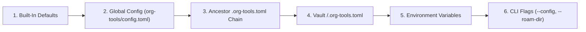

<!--
Copyright (C) 2026 org-tools contributors
SPDX-License-Identifier: GPL-3.0-or-later
-->

# Configuration Guide

## Overview

**What you will learn:**

- Why `org-tools` ships conservative defaults and what problems `.org-tools.toml` solves.
- How global, workspace, per-vault, environment, and CLI settings layer together.
- How to set up personal defaults, shared workspace rules, and vault-specific overrides.

`org-tools` requires zero configuration to format, lint, query, or update standard Org-mode files.
Out of the box, every rule mirrors vanilla Emacs Org-mode so running `org` never imposes unexpected style rewrites.
Adding `.org-tools.toml` unlocks opinionated team formatting, named multi-vault routing, custom TODO workflows, and authoring hygiene checks.

### Why Configure `org-tools`

Creating a declarative `.org-tools.toml` file solves four recurring pain points across editors, terminals, and CI pipelines:

- **Consistent Formatting Across Tools**: Every contributor, Language Server (`org lsp`), Model Context Protocol client (`org mcp`), and CI check shares identical formatting and lint rules.
- **Zero-Path Vault Switching**: Registering `[roam.directories]` once lets you run `org next --roam-dir work` from anywhere instead of typing long directory paths.
- **Stricter Knowledge Hygiene**: Opt-in lint rules (`W038`, `W039`, `I008`) prevent tasks inside Zettelkasten notes, noisy `#+DATE:` headers, and oversized table cells.
- **Custom Workflows Without Emacs**: Fallback `[todo]` sequences, `[capture.templates.<name>]` scaffolds, and `[landscapes.<slug>]` filters adapt `org` to your exact domain.

### How Configuration Layers Merge

`org-tools` resolves settings hierarchically from general defaults down to specific overrides.
Later layers overwrite scalar settings from earlier layers while preserving unrelated tables.



| Layer | Source                                                                       | Typical Use                                                       |
| ----- | ---------------------------------------------------------------------------- | ----------------------------------------------------------------- |
| `1`   | Built-in Emacs-compatible defaults                                           | Safe zero-config operation on any `.org` file.                    |
| `2`   | `$ORG_TOOLS_CONFIG` or `$XDG_CONFIG_HOME/org-tools/config.toml`              | Personal `editor` command and personal formatting preferences.    |
| `3`   | Ancestor `.org-tools.toml` files (merged from outermost to current folder)   | Shared `[roam.directories]`, `[format]`, `[lint]`, `[landscapes]`.|
| `4`   | Per-vault `<roam_dir>/.org-tools.toml`                                       | Vault-specific `[todo]` sequences or capture templates.           |
| `5`   | Runtime environment variables (`ORG_ROAM_DIRECTORIES`, `ORG_TAG_COLUMN`)     | CI runner overrides, container mounts, and shell profiles.        |
| `6`   | Command-line flags (`--config`, `--roam-dir`, `--id-scope`, `--no-cache`)    | One-off command overrides (`--config` replaces layers `2..4`).    |

For every available table, key, type, and default value, see the [Configuration Reference](configuration-reference.md).

## Prerequisites

- `org` installed on your `PATH` (see [Five-Minute Quickstart](quickstart.md)).
- Optional: An Org workspace structured following [Workspace & Directory Structure](directory-structure.md).

## Steps

1. Create an optional global user configuration at `~/.config/org-tools/config.toml` for machine-specific preferences such as your preferred editor.

```sh
mkdir -p ~/.config/org-tools
cat > ~/.config/org-tools/config.toml << 'TOML'
[roam]
editor = "nvim"
TOML
```

2. Create `.org-tools.toml` at your workspace root (`~/org/.org-tools.toml`) to define formatting, lint hygiene, deadlines, and named vaults.

```toml
[format]
blank_lines = true
max_consecutive_blank_lines = 1
heading_blank_lines = true

[lint]
enable = ["W038", "W039", "I008"]
id_scope = "vault"

[lint.zettel]
forbid_tasks = true

[lint.authoring]
forbid_ephemeral_headers = true
max_table_cell_chars = 120

[agenda]
deadline_warning_days = 10

[todo]
sequences = ["TODO(t) NEXT(n) WAITING(w) | DONE(d) CANCELLED(c)"]

[roam]
default_directory = "work"
log_to_daily = true

[roam.directories]
work = "./work"
private = "./private"
```

3. Add an optional per-vault override in `~/org/work/.org-tools.toml` when one vault needs custom workflow states or capture templates.

```toml
[todo]
sequences = [
  "TODO NEXT WAITING | DONE CANCELLED",
  "DRAFT REVIEW | APPROVED REJECTED",
]

[capture.templates.adr]
description = "Architecture decision record"
keys = "a"
kind = "file"
target = "tech/adr-${slug}.org"
roam_type = "technical"
filetags = ["adr", "architecture"]
body = "* Context\n${body}\n\n* Decision\n\n* Consequences\n"
```

4. Inspect the merged capture templates and provenance layers (`builtin`, `global`, `workspace`, `vault`) for your `work` vault.

```sh
org roam capture --roam-dir work --list-templates --format json
```

5. Validate your `.org` files against the active configuration rules.

```sh
org fmt check ~/org
```

## Expected Outcome

`org roam capture --roam-dir work --list-templates --format json` shows all 10 built-in templates alongside `adr` tagged with `"source_layer": "vault"`.
`org fmt check ~/org` enforces single blank lines, heading spacing, Zettelkasten task hygiene, and vault-wide `:ID:` link resolution.

## Power-User & Scripting Options

Override configuration files cleanly in CI pipelines or isolated scripts without modifying files on disk:

```sh
# Pin an explicit configuration file for a single CI check, bypassing ancestor discovery
org --config ./ci/strict-org-tools.toml fmt check .

# Override configured roam directories dynamically via environment variable
ORG_ROAM_DIRECTORIES="work=/tmp/work_vault,private=/tmp/priv_vault" org next --roam-dir work
```

??? info "Deep Dive: Path Expansion and Table Merge Rules"

    Relative paths inside `[roam.directories]`, `default_directory`, and `body_file` always resolve against the directory of the `.org-tools.toml` file that declared them.
    Paths starting with `~/`, `$HOME/`, or `${HOME}/` expand against `$HOME` (falling back to `$USERPROFILE` on Windows).
    During hierarchical merging, nested tables merge key by key except `directories`, where a closer layer's `[roam.directories]` replaces parent vault maps cleanly.

## Troubleshooting

| Symptom                                              | Cause                                                           | Fix                                                                               |
| ---------------------------------------------------- | --------------------------------------------------------------- | --------------------------------------------------------------------------------- |
| `error parsing .../.org-tools.toml` (exit code `2`)  | Syntax error or wrong value type in TOML file                   | Check the reported line against the [Configuration Reference](configuration-reference.md) |
| Custom `[todo]` state is ignored in a specific file  | That `.org` file defines its own `#+TODO:` or `#+SETUPFILE:`    | Add the state to the file's `#+TODO:` line, which overrides `[todo]` fallback     |
| Global `config.toml` is not picked up                | `$XDG_CONFIG_HOME` points to a custom directory                 | Place `org-tools/config.toml` inside `$XDG_CONFIG_HOME` or set `ORG_TOOLS_CONFIG` |
| Relative vault path points to the wrong subfolder    | Path was written relative to `cwd` instead of the config folder | Anchor relative paths in `.org-tools.toml` to the directory containing that file  |
