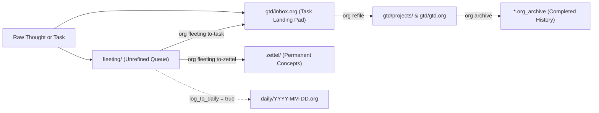

<!--
Copyright (C) 2026 org-tools contributors
SPDX-License-Identifier: GPL-3.0-or-later
-->

# Workspace & Directory Structure

## Overview

**What you will learn:**

- Why `org-tools` separates life domains into independent vaults and splits tasks from permanent notes.
- How the four core subdirectories (`gtd/`, `fleeting/`, `zettel/`, `daily/`) and companion folders work together.
- How dynamic `:agenda:` filetags and four-stage project resolution keep large vaults fast.

`org-tools` works on any standalone `.org` file out of the box.
However, its capture, GTD, fleeting-note, and agenda commands are built around an opinionated multi-vault layout.
Adopting this structure separates actionable commitments from evergreen knowledge so neither system clutters the other.

### Why Separate Vaults and Subdirectories

Storing every meeting note, half-formed idea, active task, and concept note in one flat folder creates friction.
Queries slow down, private errands leak into work reviews, and permanent notes turn into stale task graveyards.

`org-tools` solves these problems through two structural boundaries:

- **Multi-Vault Isolation (`work/` vs `private/`)**: Each domain lives in its own directory with an independent `.cache/org-cache.db` SQLite index and Git history.
- **Role-Specific Subdirectories**: Intake (`fleeting/`), commitments (`gtd/`), permanent concepts (`zettel/`), and time logs (`daily/`) stay cleanly separated inside each vault.



### Canonical Directory Layout

Every vault follows the same predictable directory tree configured in [`.org-tools.toml`](configuration.md):

```text
~/org/
├── .org-tools.toml                # Shared workspace rules & [roam.directories]
├── work/                          # Work domain vault (--roam-dir work)
│   ├── .org-tools.toml            # Optional work-only overrides
│   ├── .cache/org-cache.db        # Disposable SQLite WAL + FTS5 index (git-ignored)
│   ├── gtd/                       # Actionable GTD system (gtd_subdir)
│   │   ├── inbox.org              # Unclarified task capture pad (:agenda:)
│   │   ├── gtd.org                # Single-step next actions & waiting items (:agenda:)
│   │   ├── projects.org           # Outline-based multi-step projects (:agenda:)
│   │   ├── habits.org             # Recurring org-habit routines (:agenda:)
│   │   ├── calendar.org           # Fixed-date appointments (:agenda:)
│   │   └── projects/              # One-file-per-project roam nodes (-t project)
│   ├── fleeting/                  # Luhmann intake queue (fleeting_subdir)
│   ├── zettel/                    # Permanent atomic concept notes (zettel_subdir)
│   ├── daily/                     # Date-stamped daily journals (daily_subdir)
│   ├── tech/                      # Architecture & debugging notes (-t technical)
│   ├── howto/                     # Step-by-step operational recipes (-t howto)
│   ├── people/                    # Contact & stakeholder notes (-t person)
│   └── places/                    # Location reference notes (-t place)
└── private/                       # Personal domain vault (--roam-dir private)
    └── gtd/ fleeting/ zettel/ daily/ ...
```

| Path                        | Built-In Role & Lifecycle                                                                                 |
| --------------------------- | --------------------------------------------------------------------------------------------------------- |
| `gtd/inbox.org`             | Receives quick tasks from `org roam gtd inbox` and `org roam capture -t inbox` before clarification.      |
| `gtd/gtd.org`               | Holds clarified single-action `NEXT` and `WAITING` tasks that do not belong to a larger project.          |
| `gtd/projects.org`          | Stores compact multi-step projects as level-1 headings when a full project file is unnecessary.           |
| `gtd/habits.org`            | Tracks recurring routines carrying `:STYLE: habit` and `.+1d` or `+1w` repeaters.                         |
| `gtd/calendar.org`          | Records hard date-specific commitments and milestones projected onto `org query agenda`.                  |
| `gtd/projects/<slug>.org`   | Dedicated `org-roam` v2 project nodes (`:TYPE: project`) for larger initiatives with notes and links.     |
| `fleeting/<ts>-<slug>.org`  | Temporary Luhmann scratchpad (`:STATUS: unrefined`) refined into `zettel/`, `gtd/inbox.org`, or trash.    |
| `zettel/<slug>.org`         | Evergreen atomic concept notes (`:TYPE: concept`) linked via `[[id:<uuid>][Title]]` without active tasks. |
| `daily/YYYY-MM-DD.org`      | Chronological journal notes and optional automatic capture logs (`log_to_daily = true`).                  |
| `tech/`, `howto/`           | Practical engineering notes (`-t technical`) and repeatable procedures (`-t howto`).                      |
| `people/`, `places/`        | Reference nodes for colleagues (`-t person`, useful for `WAITING` tasks) and locations (`-t place`).      |

## Prerequisites

- `org` installed on your `PATH` (see [Five-Minute Quickstart](quickstart.md)).
- Git installed if you plan to version-control your vaults.

## Steps

1. Create the root workspace folder along with the core subdirectories for `work` and `private` vaults.

```sh
mkdir -p ~/org/work/{gtd/projects,fleeting,zettel,daily,tech,howto,people,places}
mkdir -p ~/org/private/{gtd/projects,fleeting,zettel,daily}
cd ~/org
```

2. Ignore the disposable SQLite cache directory so binary index files never enter Git commits.

```sh
printf ".cache/\n*.db-wal\n*.db-shm\n" > ~/org/.gitignore
```

3. Create `~/org/.org-tools.toml` to register both vaults and enforce Zettelkasten hygiene rules (see the [Configuration Guide](configuration.md)).

```toml
[roam]
default_directory = "work"
log_to_daily = true

[roam.directories]
work = "./work"
private = "./private"

[lint]
enable = ["W038", "W039"]

[lint.zettel]
forbid_tasks = true
```

4. Seed the five base GTD files in `work/gtd/` and synchronize their `:agenda:` filetags.

```sh
for f in inbox gtd projects habits calendar; do
  printf "#+title: %s\n#+filetags: :agenda:\n" "$f" > "work/gtd/${f}.org"
done
org roam sync-agenda-tags --roam-dir work
```

5. Capture your first inbox task, dedicated project file, fleeting thought, and permanent Zettel.

```sh
org roam gtd inbox "Review Q4 latency numbers" --context @office --effort 0:30
org roam gtd project "Zero-Downtime Auth Migration" --next-action "Draft rollout checklist"
org fleeting capture "SQLite WAL avoids reader locks" --body "Readers never block writers."
org roam capture -t zettel --title "Write-Ahead Logging Concurrency" --no-edit
```

6. Verify formatting, link integrity, and Zettelkasten task hygiene across the entire workspace.

```sh
org fmt check ~/org
org next --roam-dir work
```

## Expected Outcome

`org fmt check ~/org` exits with code `0`, confirming aligned drawers, valid `:ID:` links, and zero tasks inside `zettel/`.
`org next --roam-dir work` lists your actionable work tasks grouped by owning project without mixing in `private/` items.

## Power-User & Scripting Options

Run `org roam sync-agenda-tags` in a Git hook or cron job if external tools edit `.org` files directly:

```sh
# Preview dynamic :agenda: filetag additions and removals without writing files
org roam sync-agenda-tags --dry-run --format json
```

All `org` mutation commands (`org update`, `org roam gtd`, `org fleeting`, `org refile`, `org archive`) update `:agenda:` filetags automatically.
The five base GTD files (`inbox.org`, `gtd.org`, `projects.org`, `habits.org`, `calendar.org`) retain `:agenda:` permanently even when empty.
Every other file gains `#+filetags: :agenda:` when an active task appears and drops `:agenda:` once all tasks finish.

??? info "Deep Dive: Four-Stage Owning Project Resolution"

    When `org next` groups or filters tasks by `--project`, it resolves each task's owning project in four stages:

    1. **Explicit Property**: Checks `:PROJECT:` (supporting `[[id:<uuid>][Title]]` links) or `:PROJECT_ID:` on the task or its ancestors.
    2. **Ancestor Project Heading**: Checks parent headings carrying the `PROJECT` keyword, `:project:` tag, `:TYPE: project`, or level-1 position inside `projects.org`.
    3. **Enclosing Project File Node**: Checks whether the file carries `:TYPE: project`, `#+filetags: :project:`, or lives inside `gtd/projects/`.
    4. **Category Fallback**: Falls back to inherited `:CATEGORY:`, buffer `#+CATEGORY:`, or the filename stem.

## Troubleshooting

| Symptom                                              | Cause                                                           | Fix                                                                               |
| ---------------------------------------------------- | --------------------------------------------------------------- | --------------------------------------------------------------------------------- |
| `warning [W038/zettel-task-hygiene]` in `zettel/`    | A permanent concept note contains an active `TODO` or checklist | Move actionable items to `gtd/inbox.org` via `org refile` and keep concepts pure  |
| Completed project file still appears in agenda scans | External editor marked tasks `DONE` without updating filetags   | Run `org roam sync-agenda-tags` to strip `:agenda:` from finished project files   |
| `unknown roam directory: work` error                 | Command ran outside `~/org` without `--workspace` configured    | Pass `--workspace ~/org` or export `ORG_TOOLS_WORKSPACE="$HOME/org"`              |
| Tasks from `private/` appear in work queries         | Query scanned `~/org` directly instead of a named vault         | Pass `--roam-dir work` or set `default_directory = "work"` in `.org-tools.toml`   |
